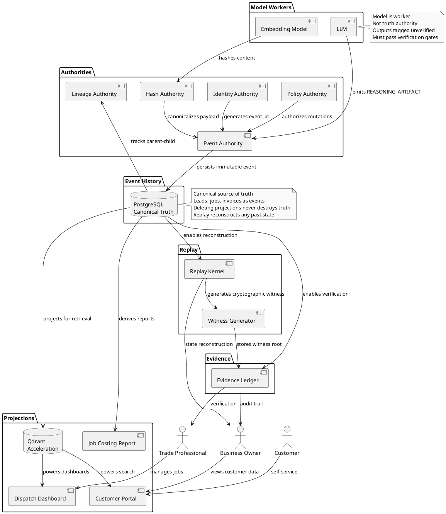

# PING Constitutional Architecture

**Document Purpose:** Explain the technical moat - what is technically different about PING.

**Status:** Canonical Architecture Document

**Date:** 2026-09-12

---

## Executive Summary

PING is not another AI wrapper. PING is building a trustworthy execution substrate around commodity AI models to power reliable business automation for home-service businesses.

The technical moat is not commodity AI models. The moat is:

- Deterministic state reconstruction
- Constitutional authority consolidation
- Event-lineage provenance
- Replay verification
- Evidence and witness generation
- Sovereignty over projections
- Fail-closed capability boundaries
- Source-of-truth enforcement

PING treats models as workers inside a constitutional operating substrate, not as truth authorities. This substrate powers business automation: lead capture, scheduling, dispatch, invoicing, job costing, and customer communication.

---

## Constitutional Rule of One

### One Authority Per Truth Domain

PING enforces that every truth domain has exactly one canonical authority. Duplicate authorities create ambiguity and unreliability. For a business automation platform, this means one source of truth for leads, jobs, invoices, and customer records.

**Implemented authorities:**
- Canonicalization Authority (frozen constitutional law)
- Hash Authority (frozen constitutional law)
- Lineage Authority (frozen constitutional law)
- Policy Authority (frozen constitutional law)

**Planned authorities:**
- Identity Authority (partial implementation, requires migration)
- Witness Authority (specification exists in calm-garden)
- Replay Authority (specification exists, partial implementation)
- Truth Authority (specification exists as TRUTH_LAW.md)

**Identified duplicate authorities (audited but not yet consolidated):**
- Multiple event construction paths (repository_client.emit_event() vs direct INSERT in 6 files)
- Multiple hashing mechanisms (CanonicalHashAuthority vs direct hashlib.sha256() in projection worker)
- Multiple authority classification schemes (declared class string, file-path-based, integer SQL)
- Divergent constitutional documents (constitution/ vs vault/laws/ on replay_law and witness_law)

**Status:** Constitutional audits have identified duplicates. Consolidation is in progress. The Rule of One is a frozen constitutional principle, but the repository has not yet achieved full consolidation.

---

## Identity Authority

### Purpose

Identity Authority owns all constitutional identity generation across the system. For business automation, this means deterministic IDs for leads, customers, jobs, estimates, invoices, and all business entities.

**Constitutional constraint:** There shall be only one identity authority across all runtimes. No worker may independently call uuid.uuid4() or equivalent.

**Current state:** Identity Authority exists (IdentityAuthority.generate_deterministic_id()). Multiple workers violate this by calling uuid.uuid4() directly.

**Status:** Frozen constitutional principle. Violations are documented. Migration is planned.

---

## Event Sourcing and Canonical Event Authority

### Canonical Event Envelope

**Status:** Target specification exists. Multiple competing event schemas exist in the repository.

**Target structure:**
```json
{
  "event_id": "",
  "event_type": "",
  "actor_id": "",
  "timestamp": "",
  "payload": {},
  "lineage": {},
  "policy_version": ""
}
```

**Business event types (partial inventory from opportunity audit):**
- LEAD_CREATED, LEAD_CONVERTED
- ESTIMATE_CREATED, ESTIMATE_SENT, ESTIMATE_ACCEPTED
- INVOICE_CREATED, INVOICE_SENT, INVOICE_PAID
- PROJECT_CREATED, PROJECT_COMPLETED
- REVIEW_RECEIVED
- JOB_STARTED, JOB_COMPLETED

**Current drift:**
- COS audit-event.schema.json (governance audit)
- Runtime execution_events table (artifact commits)
- UCIA claim/decision lifecycle events
- UnifiedEventRuntime event envelope (curious-squid worktree)

**Status:** Schema consolidation is planned. No single canonical event envelope exists across the repository yet.

---

### Event Authority

**Status:** Partial implementation. Multiple violations exist.

**Canonical path:** repository_client.emit_event() constructs canonical event envelopes using IdentityAuthority and CanonicalHashAuthority.

**Violations (audited):**
- runtime/workers/github_worker.py: Direct INSERT to events table
- runtime/adapters/google_drive/google_drive_ingestion_adapter.py: Direct INSERT with uuid.uuid4()
- repository_scanner.py: Direct INSERT with uuid.uuid4()
- repository_event_layer.py: Direct INSERT with uuid.uuid4() (classified as SECOND EVENT AUTHORITY violation)

**Status:** Migration to canonical event authority is planned. P0/P1 verification failed/partial in constitutional specification audit.

---

## Canonicalization

### Purpose

Canonicalization defines deterministic byte representation for hashing, identity generation, replay determinism, and witness generation. For business automation, this means consistent serialization of business data across all systems.

**Constitutional constraint:** There shall be only one canonicalization authority across all runtimes (Python, JavaScript, TypeScript, Rust, WASM).

**Rules:**
- Arrays preserve insertion order, no spaces, comma-separated
- Objects sort keys in UTF-8 byte order, no spaces, colon-separated
- Unordered collections sort elements before serialization
- Type-safe byte wrapping
- Language-independent determinism

**Status:** Frozen specification exists (CANONICALIZATION_LAW.md). Implementation consolidation across runtimes is planned.

---

## Deterministic Hashing

### Purpose

Hash Authority defines the constitutional hash algorithm for all constitutional data structures. For business automation, this means consistent content-addressing of business records.

**Constitutional constraint:** There shall be only one canonical hash algorithm across all runtimes.

**Rules:**
- SHA-256 is the only hash algorithm
- Input must be canonical bytes per Canonicalization Law
- Hexadecimal output must be lowercase
- Fixed 64-character length
- No salting, no random elements
- Deterministic output

**Status:** Frozen specification exists (HASH_LAW.md). Implementation violations exist (direct hashlib.sha256() calls in qdrant_projection_worker.py). Constitutional specification is required before patching to determine scope of CanonicalHashAuthority.

---

## Replay Kernel and Deterministic Replay

### Replay Law

**Status:** Frozen constitutional law (constitution/replay_law.md with formal invariants)

**Purpose:** Define replay as the authoritative reconstruction of constitutional state from immutable event history. For business automation, this means reconstructing any past business state for audit, verification, or training.

**Constitutional rules:**
- Replay order is determined only by sequence number
- Replay must not use timestamp, UUID, or database order
- Replay inputs are immutable
- Boundaries freeze ownership
- Hashing routes through hash authority
- Canonical serialization has one authority
- Persistence is never the authority
- Deleting the database and replaying should produce identical state

**Implementation status:**
- Specification exists and is frozen
- DeterministicReplayEngine exists in calm-garden (TypeScript)
- Witness generation exists in calm-garden
- Replay corpus specification exists (REPLAY-CORPUS.md)
- Runtime replay implementation is partial
- Integration between curious-squid event spine and calm-garden replay engine is planned

---

### Deterministic Replay Kernel

**Status:** Specification exists. Partial implementation in calm-garden.

**Purpose:** Pure, side-effect-free, infrastructure-independent replay engine.

**Design:**
- Canonical hashing
- Invariant verification
- Witness generation
- Merkle-tree construction
- Replay reproducibility

**Status:** TypeScript implementation exists in calm-garden. Python implementation is planned. Integration with live event spine is planned.

---

## Provenance and Evidence

### Lineage Law

**Status:** Frozen constitutional law (LINEAGE_LAW.md)

**Purpose:** Define constitutional authority for lineage tracking across all constitutional artifacts. For business automation, this means tracking parent-child relationships between leads, estimates, jobs, invoices, and all business entities.

**Constitutional constraint:** There shall be only one lineage authority across all runtimes.

**Rules:**
- Lineage edges are immutable once recorded
- Lineage graph must remain acyclic
- Every artifact must have complete lineage traceability
- Edge types: DERIVED_FROM, VERSION_OF, DEPENDS_ON, REFERENCES

**Status:** Frozen specification exists. Implementation is partial across workers.

---

## Witness Generation

### Witness Authority

**Status:** Specification exists in calm-garden. Partial implementation.

**Purpose:** Generate cryptographic witnesses from event streams to enable verification of replay correctness. For business automation, this means cryptographic verification that business records were not tampered with.

**Design:**
- Witnesses computed from event streams, canonicalization, fingerprints, invariant verification, replay state, and witness roots
- Merkle-tree construction
- Witness roots computed without recursive serialization
- Witness creation centralized

**Status:** Implementation exists in calm-garden. Integration with canonical event spine is planned.

---

## Projection Sovereignty

### PostgreSQL as Canonical Truth

**Principle:** PostgreSQL event history is the canonical source of truth. All business records (leads, jobs, invoices, customers) exist as immutable events in the event log.

**Constitutional rules:**
- Events are authoritative records
- Persistence is derived storage, not truth authority
- Deleting projections must never destroy truth
- Event history enables reconstruction of any past state

**Status:** Event spine exists (UnifiedEventRuntime in curious-squid). Event persistence to ping_events table is implemented.

---

### Qdrant as Acceleration Layer

**Principle:** Qdrant is a projection acceleration layer, not a truth authority. All projections must be verifiable against canonical source events in PostgreSQL.

**Constitutional rules:**
- Projections are derived storage, not truth authority
- Events, evidence, and witnesses are authoritative records
- Projection admission must verify against canonical source
- Retrieval must include verification chain
- Deleting Qdrant must never destroy truth

**Implementation status:**
- Constitutional Remediation V3 (Session 3) fixed /constitution/search to verify each Qdrant result against Postgres
- Fixed authority_search.py to remove projection evidence weight from authority computation
- Fixed model output events to tag as REASONING_ARTIFACT with _verified: false
- Fixed qdrant_projection_worker.py to block unverified REASONING_ARTIFACT from projection
- Capped newsletter topic confidence at 0.6

**Remaining gaps (audited but not yet patched):**
- ContextPack exists but not enforced via gateway middleware
- Direct Qdrant retrieval without verification in some paths
- Namespace inconsistency across projection types
- Projection metadata introduced inconsistently

**Status:** Projection sovereignty is a frozen constitutional principle. Verification infrastructure is partially implemented. Full enforcement is planned via PATCH-009 (ContextPack mandatory enforcement).

---

## Failure Law

**Status:** Frozen constitutional principle (from UCIA-CONSTITUTION-v1.0.md in archive).

**Purpose:** Define constitutional handling of failures, errors, and exceptions. For business automation, this means deterministic failure handling that preserves audit trails.

**Constitutional rules:**
- Failure envelopes must be deterministic and replay-safe
- Failures must be recorded as constitutional events
- Failure handling must not introduce nondeterminism
- Failure recovery must be replayable

**Status:** Specification exists in archive. Implementation consolidation is planned.

---

## Authority Versus Worker Separation

### Constitutional Principle

**Status:** Frozen constitutional principle.

**Principle:** An authority/worker split is legitimate only when the worker cannot independently exercise the underlying authority capability.

**Examples:**
- CanonicalHashAuthority owns hashing. Workers call authority.hash() but cannot independently call hashlib.sha256().
- IdentityAuthority owns identity generation. Workers call authority.generate_id() but cannot independently call uuid.uuid4().
- Event Authority owns event construction. Workers call repository_client.emit_event() but cannot independently INSERT to events table.

**Violations (audited):**
- Multiple workers call hashlib.sha256() directly (P0-1 violation in PING_CONSTITUTIONAL_SPECIFICATION.md)
- Multiple workers call uuid.uuid4() directly (Identity Authority violations)
- Multiple files INSERT directly to events table (Event Authority violations)

**Status:** Constitutional principle is frozen. Violations are documented. Migration to authority/worker separation is planned.

---

## Runtime Nondeterminism Control

**Status:** Audited. Violations exist.

**Identified nondeterminism sources (audited):**
- json.dumps() without sort_keys=True in repository_client.py
- os.listdir() order non-deterministic in drive_indexer
- Container creation time wall clock used in business logic
- Subprocess spawning violations (5 violations in runtime)

**Status:** PATCH-010 planned to fix JSON dumps and os.listdir nondeterminism. Subprocess violations are documented but not yet addressed.

---

## Why Deterministic Infrastructure Matters for Agentic Systems

### Problem Statement

Agentic systems that lack deterministic infrastructure suffer from:

- Hidden failures that cannot be audited
- State drift that cannot be corrected
- Hallucinations that cannot be traced to source
- Business decisions that cannot be verified
- Regulatory compliance that cannot be proven

### PING Solution

PING provides deterministic infrastructure that enables:

- Replay verification of any past state
- Cryptographic evidence of execution
- Lineage tracking of all business records
- Authority consolidation eliminating ambiguous truth
- Projection sovereignty preventing confusion between acceleration and truth

For business automation, this means owners can verify that the system recorded a lead correctly, that an invoice was generated from the correct estimate, and that job costing reflects actual labor and materials.

---

## Why Commodity AI Models Are Not the Moat

### Commodity Layer

AI models (GPT-4, Claude, etc.) are commodity infrastructure. Anyone can access them. They are not a sustainable competitive advantage.

### PING Moat

The PING moat is the constitutional infrastructure that controls how models are used:

- Models are workers, not truth authorities
- Model outputs are tagged as REASONING_ARTIFACT with _verified: false
- Unverified model outputs are blocked from projection
- Model outputs must pass verification gates before becoming business records
- Model execution is bounded by fail-closed capability boundaries

The moat is not the model. The moat is the constitutional control around the model.

---

## Fail-Closed Capability Boundaries

### Exterior-Agent Capability Gateway

**Status:** Implemented and validated in curious-squid worktree.

**Verified capabilities:**
- Gateway health
- Level 1 authentication
- Level 2 authentication
- Filesystem listing, reads, writes (path-confined to authorized workspace)
- Git status and commit (confined to authorized worktree)
- Workspace persistence across container recreation and Windows restart
- Git branch normalization to main
- Repository authorization (canonical PING explicitly denied)
- Tailscale connectivity

**Known limitations:**
- Execution capabilities (test.run, build.run, command.run) are disabled pending policy scoping
- Durable audit storage unavailable when PostgreSQL unavailable (in-memory degraded mode)
- OpenSSH public-key authentication blocked by Windows account resolution (parked)

**Status:** Exterior-agent MVP is implemented and validated for filesystem and Git capabilities. Execution capabilities remain disabled. OpenSSH integration is parked.

---

## Source-of-Truth Enforcement

### Constitutional Principle

**Status:** Frozen constitutional principle.

**Principle:** Events, evidence, and witnesses are authoritative records. Persistence, projections, and derived data are never truth authorities.

**For business automation:**
- Leads exist as LEAD_CREATED events in the event log
- Jobs exist as PROJECT_CREATED events in the event log
- Invoices exist as INVOICE_CREATED events in the event log
- Customer portals, dashboards, and reports are projections
- Deleting a dashboard must never destroy the underlying business records

**Status:** Principle is frozen. Implementation is partial across business domains.

---

## Architecture Diagram



---

## Technical Moat Summary

PING is technically different because:

1. **Constitutional Rule of One:** Every truth domain has exactly one canonical authority. Duplicate authorities are constitutional violations.

2. **Foundational primitives:** Canonicalization, hashing, lineage, and policy are frozen constitutional laws with one authority each across all runtimes.

3. **Deterministic replay:** Replay is the authoritative reconstruction of state from immutable events. Replay must not use timestamp, UUID, or database order. Deleting the database and replaying should produce identical state.

4. **Qdrant sovereignty:** Qdrant is a projection acceleration layer, not truth authority. All projections must be verifiable against canonical source events.

5. **Authority versus worker separation:** Workers cannot independently exercise authority capabilities. All hashes, identities, and events must route through canonical authorities.

6. **Evidence and witness generation:** Cryptographic witnesses enable verification of replay correctness. Evidence is derived from events, not marketing claims.

7. **Fail-closed capability boundaries:** Exterior agents operate in isolated workspaces with path confinement, repository authorization, and policy-scoped execution.

8. **Architectural audits:** Duplicate systems, authority violations, and nondeterminism are continuously audited and consolidated.

9. **Source-of-truth enforcement:** Events, evidence, and witnesses are authoritative records. Persistence, projections, and derived data are never truth authorities.

10. **Constitutional control around models:** Models are workers inside a constitutional operating substrate, not truth authorities.

The moat is infrastructure, not commodity AI models.

---

## Cross-References

- See [PING_AGENT_NETWORK.md](PING_AGENT_NETWORK.md) for where this architecture is going.
- See [PING_BUILD_JOURNEY.md](PING_BUILD_JOURNEY.md) for why Nolan is qualified to build this.
